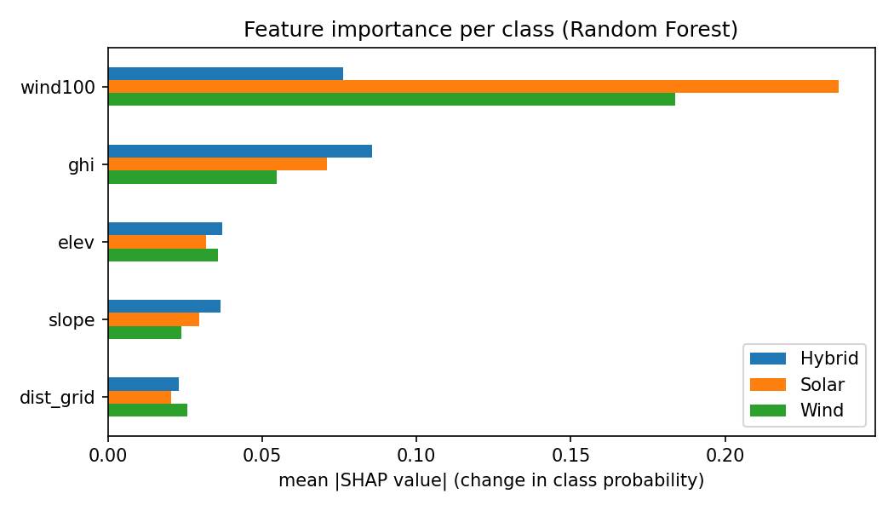
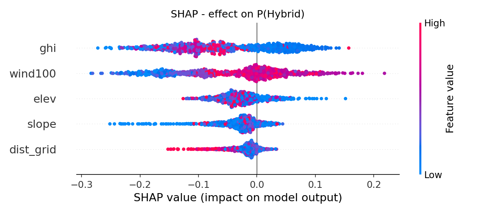

# Report notes: Predicting renewable installation type from geography

## 1. Problem statement

Given a location where an onshore, utility-scale renewable installation exists, can a model
trained on geographic and environmental factors (solar resource, wind resource, terrain, grid
proximity) predict whether it is a **Solar, Wind or Hybrid** site, including in a region it has
never seen during training, and say **"I don't know"** when it is unsure or the location is unlike
anything it was trained on?

The model answers *"if something is built here, which type fits?"*. It does **not** judge whether
a location should be developed, and it makes no claim that any location is "unsuitable".

**Short answer:** partly. Solar vs Wind transfers well to sunny southern regions (90–92% accuracy
on Iberia, Italy, and the Balkans and Greece) but fails in windy northern regions (35% on the
British Isles, 40% on the Nordic and Baltic countries); across all eight European regions held out
in turn the model is right 71% of the time. Applied unchanged to other continents, it scores 90%
on the USA, 84% on China (barely above always guessing Wind, 81%) and only 53% on India, where it
correctly answers "I don't know" for 92% of cells.
Hybrid is not learned (too few, geographically concentrated examples). "I don't know" partly works
(the low-confidence rule works; the unfamiliar-location rule is too cautious in Iberia but catches
India).

## 2. Data

**Labels: Dunnett et al. (2020), Scientific Data 7:130** (OpenStreetMap-based, 2020 snapshot).
- 35,272 solar and 33,514 wind records. Kept only records that are not flagged urban or water and
  have estimated capacity ≥ 1 MW. Capacity is only estimated for records that pass the
  authors' own "farm" filter (wind > 4 turbines; solar panel area > 1 ha), so missing capacity
  means "not a farm" and those records were dropped. This leaves 11,498 solar and 12,580 wind
  installations.
- 5 km grid in World Eckert IV (equal-area). Cell = Solar only / Wind only / **Hybrid = both in
  the same 5 km cell**. Empty cells are not used.
- Global: 18,705 cells (Wind 9,609, Solar 8,700, Hybrid 396). Hybrid ≥ 300, so it stays a class.

**Region split (confirmed by user)**
| Split | Region | Hybrid | Solar | Wind | Total |
|---|---|---|---|---|---|
| Train | Europe except Spain and Portugal (33 countries) | 308 | 5,320 | 3,548 | 9,176 |
| Test (held out) | Spain + Portugal | 25 | 758 | 765 | 1,548 |

68 cells were dropped for missing or invalid features:
- 34 northern wind cells above the solar atlas's limit (~65°N);
- 13 on the Azores/Madeira (not in the official Portugal wind file);
- 20 island cells with no Gridfinder lines (15 Canary Islands, 5 small Mediterranean islands),
  where the "nearest line" was on another coast 20–450 km away;
- 1 in Kosovo (no wind file available).

**Features**
| Feature | Source | How |
|---|---|---|
| `ghi` | Global Solar Atlas v2 GHI, 9 arc-sec | Sampled at each installation, averaged per cell |
| `wind100` | Global Wind Atlas, mean wind speed 100 m, official per-country GeoTIFFs (250 m) | Same |
| `elev` | Copernicus DEM GLO-90 | Same |
| `slope` | Horn slope from the same DEM (3×3 window) | Same |
| `dist_grid` | Gridfinder (Arderne et al. 2020): nearest grid line, mostly medium/high voltage | Cell centre to nearest line, km, in EPSG:3035 |

**Data-quality notes**
- The global wind-speed rasters found in the old `01_raw` folder (`AUTHENTIC_/VERIFIED_/GWA_v4.0_*WS100*`)
  did not match the official Global Wind Atlas. For example, they gave the Gujarat coast 4.7 m/s
  against the official 6.6 m/s, and ranked Bavaria windier than the German North Sea coast. They
  were replaced with official per-country downloads.
- Gridfinder has no lines on some islands; those cells are excluded (see above). Every cell more
  than 20 km from a line was such an island cell.

**Dataset limitations:** OSM coverage is uneven (dominated by Europe, North America and East Asia);
the data is a 2020 snapshot; capacity values are first-order estimates.

## 3. Method and key decisions

| Decision | Why |
|---|---|
| Train only on real installations (no "empty land" negatives) | Every label is an observed fact. "No plant" ≠ "unsuitable". |
| One model, 3 classes (Solar / Wind / Hybrid) | Same features and pipeline for all; simple to explain. |
| Hybrid = a 5 km cell containing both solar and wind | Consistent, reproducible. Depends on cell size. |
| Features: GHI, wind speed 100 m, elevation, slope, distance to grid | Core resource, terrain and grid factors from published siting studies (Sachit et al. 2022). |
| No land cover or road distance | The farm itself changes land cover and brings access roads (leakage). |
| Capacity only as a filter (≥ 1 MW), never a feature | Utility-scale only; as a feature the model would guess type from plant size (leakage). |
| Spatial split: whole held-out region + spatial block CV (100 km blocks, GroupKFold k=5) | Nearby sites are similar; random splits inflate scores (Roberts et al. 2017). |
| Baselines: majority class, wind-speed rule, logistic regression | Shows whether RF learned more than "windy = wind". |
| Random Forest, `class_weight="balanced"`, 300 trees, small grid (max_depth, min_samples_leaf) | Standard for tabular geospatial data, explainable with SHAP. |
| Metrics: macro F1, per-class recall, confusion matrix (accuracy secondary), bootstrap 95% CIs | Accuracy hides poor performance on the rare Hybrid class; CIs show what is real vs noise. |
| SHAP (TreeExplainer) | Shows which factor drives each class. |
| "I don't know" = low confidence OR unfamiliar location | Model should not guess outside what it learned (Meyer & Pebesma 2021). |

`random_state=42` everywhere. The test region was used once, for the final evaluation only. The
full pipeline was re-run from scratch and reproduced every output file exactly.

**Selected Random Forest:** `max_depth=10`, `min_samples_leaf=1`, 300 trees. The six grid settings
scored 0.522–0.543 in CV. The selected setting's CV score is slightly optimistic, because the same
folds were used to choose it, but the spread between settings is small.

## 4. Results

**Spatial CV, training region only (macro F1, mean ± sd over 5 block folds)**
| Model | CV macro F1 |
|---|---|
| Majority class | 0.244 ± 0.015 |
| Wind-speed rule | 0.498 ± 0.017 |
| Logistic regression | 0.477 ± 0.036 |
| **Random Forest** | **0.543 ± 0.023** |

**Held-out test region: Spain + Portugal (n = 1,548), with 95% bootstrap CIs (2,000 resamples)**
| Model | Accuracy (95% CI) | Macro F1 (95% CI) | Recall Hybrid | Recall Solar | Recall Wind | Precision Hybrid |
|---|---|---|---|---|---|---|
| Majority class | 0.490 (0.465–0.516) | 0.219 (0.212–0.227) | 0.00 | 1.000 | 0.000 | – |
| Wind-speed rule (Wind if ≥ 6.60 m/s) | 0.882 (0.866–0.899) | 0.593 (0.582–0.603) | 0.00 | 0.926 | 0.868 | – |
| Logistic regression | 0.844 (0.826–0.861) | 0.641 (0.618–0.666) | 0.56 | 0.836 | 0.860 | 0.07 |
| **Random Forest** | **0.901 (0.886–0.915)** | 0.627 (0.599–0.675) | 0.04 | 0.918 | 0.911 | 0.14 |

**Paired bootstrap differences (same resampled cells for both models)**
| Comparison | Accuracy diff (95% CI) | Macro F1 diff (95% CI) |
|---|---|---|
| RF − wind-speed rule | +0.018 (+0.005 to +0.032) | +0.034 (+0.006 to +0.082) |
| RF − logistic regression | +0.057 (+0.043 to +0.071) | −0.014 (−0.051 to +0.035) |

**Confusion matrix, RF, test region:**

| True \ Pred | Hybrid | Solar | Wind |
|---|---|---|---|
| Hybrid | 1 | 6 | 18 |
| Solar | 3 | 696 | 59 |
| Wind | 3 | 65 | 697 |


**Interpretation**
- Solar vs Wind transfers well to Iberia: 92% / 91% recall with RF. Section 4.3 shows this does
  not hold for every region.
- **RF beats the simple wind-speed rule, but only slightly.** It gains +1.8 accuracy points and
  +0.034 macro F1, and both confidence intervals are above zero, so the gain is real but small.
  Most of what the model knows is "windy = wind". This is reported as a valid finding.
- **RF vs logistic regression:** RF is clearly more accurate (+5.7 points). Their macro F1 is
  statistically tied. LR's higher Hybrid recall (0.56) comes from over-predicting Hybrid: it
  labels 199 test cells Hybrid and only 14 are correct (precision 0.07).
- **Hybrid is not really learned by any model** (RF: 1 of 25). There are only 25 test Hybrid
  cells, so Hybrid numbers are noisy, which is why the RF macro F1 CI is wide.

### 4.1 Extra checks: is the Random Forest the right choice? (training-region CV only)

These checks use the same spatial CV and never touch the test region (`src/03b_extra_checks.py`).

**Other standard classifiers**
| Model | CV macro F1 | CV accuracy |
|---|---|---|
| **Random Forest (main model)** | **0.543 ± 0.023** | 0.732 |
| Gradient boosting (HistGradientBoosting) | 0.542 ± 0.023 | 0.763 |
| Extra Trees | 0.537 ± 0.023 | 0.738 |
| k-nearest neighbours (k=15) | 0.510 ± 0.009 | 0.763 |
| Logistic regression | 0.477 ± 0.036 | 0.604 |
| SVM (RBF) | 0.476 ± 0.027 | 0.576 |

Tree ensembles are tied at the top, and gradient boosting gives no gain. The limit is the data
(few, concentrated Hybrid examples and a climate shift), not the choice of algorithm.

**Feature subsets (Random Forest)**
| Features | CV macro F1 |
|---|---|
| wind100 only | 0.503 |
| + ghi | 0.524 |
| + terrain (elev, slope) | 0.540 |
| + dist_grid (all 5) | 0.543 |

Wind speed alone gives most of the performance. GHI and terrain add a little each, and grid
distance adds almost nothing. That also means grid distance is not leaking information (for
example, through a farm's own connection line appearing in the grid map).

### 4.2 Is the Random Forest overfitting? (`outputs/overfit_check.csv`)

| Random Forest scored on | Accuracy | Macro F1 |
|---|---|---|
| Training data (seen) | 0.812 | 0.701 |
| Spatial CV: unseen 100 km blocks of the training region | 0.732 | 0.545 |
| Iberia test region (unseen) | 0.901 | 0.627 |

- **No heavy overfitting.** A Random Forest without a depth limit scores 1.000 on its own training
  data, which is what memorisation looks like. The selected model (max depth 10) scores 0.812, and
  drops only to 0.732 on unseen blocks.
- **Iberia scores higher than CV because Iberia is an easier region,** not because of leakage. The
  simple wind-speed rule shows the same jump: 0.742 in the training region, 0.882 in Iberia. In
  Iberia, wind farms stand on windy ridges and solar farms on calm, sunny plains, so wind speed
  separates them cleanly.

### 4.3 Does the result hold in other regions? (`outputs/region_holdout.csv`)

One test region can be lucky or unlucky, so Europe was split into 8 regions and each was held out
in turn: the model was trained on the other 7 and scored on the held-out one
(`src/03c_region_holdout.py`). Nothing was tuned: the Random Forest uses the settings chosen in
Step 3, and the wind-speed rule's threshold is refit on each training part. The Iberia round uses
the same training data as the main experiment and reproduces its result exactly (0.901).

| Held-out region | Cells | Hybrid | RF accuracy | RF macro F1 | Rule accuracy | RF recall Solar | RF recall Wind |
|---|---|---|---|---|---|---|---|
| Italy | 1,642 | 34 | **0.920** | 0.573 | 0.875 | 0.977 | 0.726 |
| Balkans & Greece | 547 | 6 | **0.905** | 0.595 | 0.896 | 0.927 | 0.885 |
| Iberia | 1,548 | 25 | **0.901** | 0.627 | 0.882 | 0.918 | 0.911 |
| Central & Eastern | 1,033 | 2 | 0.788 | 0.497 | 0.930 | 0.856 | 0.522 |
| France & Benelux | 1,163 | 15 | 0.768 | 0.553 | 0.801 | 0.621 | 0.845 |
| Germany & Austria | 3,133 | 215 | 0.613 | 0.472 | 0.699 | 0.719 | 0.568 |
| Nordic & Baltic | 538 | 17 | **0.396** | 0.307 | 0.712 | 0.307 | 0.413 |
| British Isles | 1,120 | 19 | **0.350** | 0.205 | 0.349 | 0.006 | 0.987 |

All 8 regions pooled (every cell predicted by a model that never saw its region): accuracy 0.712,
macro F1 0.523.

- **The result depends strongly on the region.** Sunny southern regions score 90–92%; windy
  northern regions fail. Iberia, the planned test region, turned out to be easier than average.
- **Why the British Isles fail:** solar farms in the UK and Ireland stand at a median wind speed
  of 7.7 m/s, windier than the typical wind farm elsewhere in Europe (7.4 m/s). The model learned
  "windy means wind farm" in absolute terms, so it labels almost every British solar farm as wind
  (Solar recall 0.006).
- **The simple wind-speed rule beats the Random Forest in four regions** (Central & Eastern,
  France & Benelux, Germany & Austria, Nordic & Baltic). The Random Forest wins clearly only in the
  south. Its extra flexibility helps where the training data looks like the test region and hurts
  where it does not.
- **Tried fix: relative features** (`src/03e_relative_features.py`). Adding each site's wind
  speed and sunshine minus its country's median raised the pooled accuracy only from 0.712 to
  0.733 (British Isles 0.35 → 0.38, but Italy 0.92 → 0.89) and lowered macro F1 slightly, so the
  main model keeps its 5 features. A better fix needs local context, such as wind speed compared
  with the surrounding 50 km of land (future work).

### 4.4 Other continents: USA, China and India (`outputs/other_continents.csv`)

The Random Forest trained in Step 3 (Europe without Iberia) was applied **unchanged** to the USA,
China and India: no retraining, no tuning. Features were built exactly as in Step 2 (official
per-country Global Wind Atlas files, the same Global Solar Atlas, Copernicus DEM and Gridfinder
layers), and the "I don't know" rules used the same thresholds as Step 5
(`src/03d_other_continents.py`). Cells with no Gridfinder line within 20 km or a missing value were
dropped (USA 16, China 13).

| | USA | China | India |
|---|---|---|---|
| Cells (Solar / Wind / Hybrid) | 2,326 (855 / 1,470 / 1) | 2,300 (407 / 1,853 / 40) | 777 (208 / 566 / 3) |
| Always guessing the most common class | 0.632 | 0.806 | 0.728 |
| **Random Forest accuracy** | **0.896** | **0.839** | **0.533** |
| Wind-speed rule accuracy | 0.927 | 0.823 | 0.541 |
| RF recall Solar / Wind | 0.844 / 0.927 | 0.737 / 0.880 | 1.000 / 0.364 |
| RF recall Hybrid | 0 of 1 | 0 of 40 | 0 of 3 |
| "I don't know" (share of cells) | 49.6% | 76.0% | **92.1%** |
| Accuracy on the cells it answers | 0.871 | 0.730 | 0.770 |
| Median wind speed: solar / wind farms (m/s) | 5.7 / 8.1 | 5.3 / 7.7 | 5.5 / 6.4 |

- **USA: the model transfers.** US wind farms sit in very windy places (median 8.1 m/s, mostly the
  Great Plains) and solar farms in calm, sunny ones, so wind speed separates them as cleanly as in
  southern Europe. As in Europe, the simple wind-speed rule does slightly better (0.927).
- **India: the model fails, but it knows.** Indian wind farms sit at a median 6.4 m/s, below the
  roughly 6.6 m/s that counts as "windy" in the European training data, so almost every Indian
  site is predicted Solar (Wind recall 0.364). The result, 0.533, is worse than always guessing
  Wind (0.728). But India is far sunnier than any training cell (median GHI 5.4 kWh/m²/day), so
  the unfamiliar-location rule flags 92% of Indian cells as "I don't know". In Iberia that rule
  looked over-cautious; India is the situation it is designed for.
- **China: reasonable, but mostly wind speed and class balance.** Chinese wind farms are much
  windier than solar farms (7.7 vs 5.3 m/s), so 0.839 accuracy follows. But 81% of Chinese cells
  are Wind, so always guessing Wind already scores 0.806, and the wind rule 0.823: the Random
  Forest adds only 1.6 points. Hybrid: 0 of 40, the largest Hybrid test outside Europe, which
  confirms Hybrid is not learned. Here the "I don't know" rule does not help: it abstains on 76%
  of cells, yet the answered cells are less accurate (0.730) than all cells together.
- Together with Section 4.3, this confirms that the model's main limitation is absolute wind
  speed: it works where wind farms are much windier than solar farms (southern Europe, the USA,
  largely China) and fails where they are not (British Isles, India).
- Macro F1 is not compared for the USA and India because they have only 1–3 Hybrid cells; China's
  RF macro F1 is 0.514.

## 5. SHAP findings (`outputs/shap_*.png`, `outputs/feature_importance.csv`)

Mean |SHAP|, averaged over classes: **wind100 0.166** > ghi 0.070 > elev 0.035 > slope 0.030 > dist_grid 0.023.






- **Solar:** low wind speed is the strongest push towards Solar; high GHI adds to it.
- **Wind:** the mirror image, mainly high wind speed.
- **Hybrid:** medium-to-high wind and *low* GHI raise P(Hybrid). In training, Hybrids are
  concentrated in northern Germany and Denmark (213 of 308 training Hybrids are in Germany). The
  model therefore learned "Hybrid = windy, not very sunny", which does not hold in sunny Iberia
  (test GHI median 4.6 vs train 3.1 kWh/m²/day). This explains the very low Hybrid recall.
- Terrain and grid distance contribute, but much less than the two resource variables. This agrees
  with the feature-subset check.

## 6. "I don't know" (`outputs/dont_know_summary.csv`, `outputs/test_predictions.csv`)

- Rule A: max class probability < 0.5.
- Rule B: weighted (RF importance) standardised feature distance to the nearest training cell is
  above 0.141, the 95th percentile of the same distance for training cells measured against other
  spatial CV folds.

| Subset | Cells | Accuracy | Macro F1 |
|---|---|---|---|
| All test cells | 1,548 | 0.901 | 0.627 |
| Confident only | 925 (59.8%) | 0.938 | 0.626 |

- "I don't know" for **40.2%** of test cells: 10.2% low confidence, 32.1% unfamiliar (some overlap).
- By true class: Hybrid 64%, Wind 56%, Solar 24%.
- **Rule A works as intended:** low-confidence cells would have been only ~45–56% correct.
- **Rule B is too cautious here:** the 465 cells flagged only as unfamiliar would have been
  97% correct. Iberia's GHI and elevation lie mostly outside the training range (test median
  elevation 717 m vs 148 m), so many cells look unfamiliar. But the decision relies mainly on wind
  speed, which transfers well. Rule B correctly warns that the test region is outside the training
  conditions; in this case that did not translate into wrong predictions.

## 7. Limitations

- OSM-based labels are incomplete and regionally uneven; the data is a 2020 snapshot; capacity is
  estimated.
- Hybrid depends on the 5 km cell definition: co-location, not necessarily a joint project. Only
  308 training and 25 test Hybrid cells, mostly from one country (Germany).
- Training and test climates differ strongly (Iberia is sunnier and higher), which is the point of
  the test, but it limits how much transfer can be expected for Hybrid.
- Features are averaged over the installations in a cell; distance to grid uses the cell centre.
  Gridfinder is partly predicted, covers mostly medium/high-voltage lines, and misses some islands
  (those cells are excluded).
- The model predicts technology type *given* an installation exists. It does not judge whether
  a location should be developed.
- The simple wind-speed rule performs close to the Random Forest on Iberia (+1.8 accuracy points)
  and beats it in four of the eight held-out regions.
- **The model does not transfer to windy northern regions** (35% on the British Isles, 40% on the
  Nordic and Baltic countries) or to India (53%), because it relies on absolute wind speed. It
  does transfer to the USA (90%) and partly to China (84%, close to always guessing Wind).
- The unfamiliar-location rule is a rough safety net: it caught India, but in China the cells it
  answered were less accurate than average.
- The Rule B threshold (95th percentile) is a convention, not tuned; it flagged many cells the
  model got right.

## 7.1 Conclusion

- Geography separates solar from wind farms well in sunny southern Europe (90–92% on three
  different held-out regions), mostly through wind speed.
- The same model fails in windy northern Europe, where solar farms are built in windy places too.
  Across all eight held-out regions it is right 71% of the time.
- On other continents it works for the USA (90%), partly for China (84%, only 3 points above always
  guessing Wind) and fails for India (53%), where Indian wind farms are less windy than European
  ones; there it answers "I don't know" for 92% of cells.
- Hybrid sites are not learned with this data.
- The model can say "I don't know": the low-confidence rule works; the unfamiliar-location rule is
  too cautious in Iberia but correctly catches India.
- Next steps: relative (region-normalised) features, more Hybrid examples from other continents,
  a calibrated unfamiliar-location threshold, and a label cross-check with Global Energy Monitor.

## 7.2 Using the model on new locations: an explicit assumption

The model is trained only on places where farms were actually built. On its own it therefore
answers *"given a farm exists here, which type is it?"*. To use it on a **new** location, one
further assumption is needed:

> **Assumption:** existing utility-scale installations reflect well-informed siting decisions.
> Under this assumption, the model recommends which technology (Solar, Wind or Hybrid) best fits
> a location *if it is developed*, and answers "I don't know" when the location is unlike the
> places it learned from or the evidence is unclear.

**Why the assumption is reasonable:** developers assess wind and solar resource, terrain and grid
access before building, so real installations carry that expert information. The same idea, using
existing plants as evidence of suitable sites, underlies Sachit et al. (2022).

**Why it is only partly true (evidence from this project):**
- Siting also follows land prices, subsidies, permits and existing grid connections. UK solar
  farms stand in windy places (median 7.7 m/s) for those reasons, not because windy land suits solar.
- Accuracy depends strongly on the region (35% British Isles to 92% Italy), so the recommendation
  is only trustworthy where the model was shown to work.
- OpenStreetMap covers some countries much better than others, so "expert decisions" are mostly
  European, American and Chinese ones.

**How to use it correctly:**
1. Read the output as "which type fits *if* something is built here", never "build here". The
   model never saw unsuitable land, so it cannot flag a protected forest, a city or a lake.
2. Respect "I don't know": if either rule fires, do not use the prediction.
3. Trust it most in regions resembling those where it scored well (southern Europe, the USA).

## 8. Reproduce

```
python src/01_prepare_labels.py
python src/02_extract_features.py   # reads Copernicus DEM from AWS (cached in data/processed/dem_points.csv)
python src/03_train_evaluate.py
python src/03b_extra_checks.py      # optional: model comparison + feature subsets (training region only)
python src/03c_region_holdout.py    # optional: each of 8 regions held out in turn + overfitting check
python src/03d_other_continents.py  # optional: Europe-trained model on the USA, China and India (needs their GWA files)
python src/03e_relative_features.py # optional experiment: relative wind/sun features (not adopted)
python src/04_explain.py
python src/05_dont_know.py
```

## 9. References and what we used them for

**Papers**

| Reference | What we used it for |
|---|---|
| Dunnett, S., Sorichetta, A., Taylor, G. & Eigenbrod, F. (2020). Harmonised global datasets of wind and solar farm locations and power. *Scientific Data* 7, 130. | All labels: solar and wind farm locations, plus the authors' recommended "real farm" filter |
| Breiman, L. (2001). Random Forests. *Machine Learning* 45(1), 5–32. | The main model (Random Forest) |
| Sachit, M. S., Shafri, H. Z. M., Abdullah, A. F. & Rafie, A. S. M. (2022). Global spatial suitability mapping of wind and solar systems using an explainable AI-based approach. *ISPRS Int. J. Geo-Inf.* 11(8), 422. | Precedent for Random Forest + SHAP on real wind and solar plants; choice of resource, terrain and grid features; idea of existing plants as evidence of good sites (Section 7.2) |
| Roberts, D. R. et al. (2017). Cross-validation strategies for data with temporal, spatial, hierarchical, or phylogenetic structure. *Ecography* 40, 913–929. | Why random splits overestimate accuracy on map data; spatial block cross-validation and a held-out test region |
| Meyer, H. & Pebesma, E. (2021). Predicting into unknown space? Estimating the area of applicability of spatial prediction models. *Methods in Ecology and Evolution* 12, 1620–1633. | Rule B of "I don't know": weighted feature-space distance to the training data and a cross-validation-based threshold |
| Lundberg, S. M. & Lee, S.-I. (2017). A unified approach to interpreting model predictions. *Advances in Neural Information Processing Systems* 30. | SHAP values (Section 5) |
| Lundberg, S. M. et al. (2020). From local explanations to global understanding with explainable AI for trees. *Nature Machine Intelligence* 2, 56–67. | TreeExplainer, the fast exact SHAP method for tree models |
| Arderne, C., Zorn, C., Nicolas, C. & Koks, E. E. (2020). Predictive mapping of the global power system using open data. *Scientific Data* 7, 19. | Gridfinder power-line map, used for the distance-to-grid feature |
| Horn, B. K. P. (1981). Hill shading and the reflectance map. *Proceedings of the IEEE* 69(1), 14–47. | The standard slope formula used to compute slope from elevation |
| Efron, B. & Tibshirani, R. J. (1993). *An Introduction to the Bootstrap.* Chapman & Hall. | Bootstrap 95% confidence intervals for the test results |
| Pedregosa, F. et al. (2011). Scikit-learn: Machine learning in Python. *Journal of Machine Learning Research* 12, 2825–2830. | Software for all models, cross-validation and metrics |

**Data sources**

| Source | What we used it for |
|---|---|
| Global Solar Atlas 2.0 (Solargis, World Bank Group / ESMAP), https://globalsolaratlas.info | Sunshine (GHI) feature |
| Global Wind Atlas (DTU Wind Energy, World Bank Group / ESMAP), https://globalwindatlas.info; described in Davis, N. N. et al. (2023), *Bulletin of the American Meteorological Society* 104(8), E1507–E1525 | Wind speed at 100 m, official per-country files |
| Copernicus DEM GLO-90 (European Space Agency), via https://registry.opendata.aws/copernicus-dem/ | Elevation and slope |
| GADM, Database of Global Administrative Areas, https://gadm.org | Country borders on the website maps only (not used by the model) |
